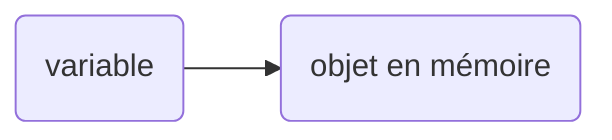
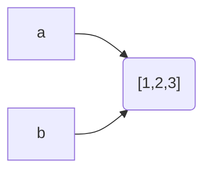

# Python : Séance 8
## Listes imbriquées, dictionnaires, tuples et références

---

## 1. Objectifs de la séance

À la fin de cette séance, les étudiants devront être capables de :

- Organiser des données dans des listes contenant plusieurs types d'éléments.
- Créer et manipuler des listes imbriquées.
- Représenter une matrice ou une grille avec une liste de listes.
- Parcourir une structure à deux dimensions avec des boucles imbriquées.
- Comprendre et utiliser les dictionnaires pour associer des clés à des valeurs.
- Parcourir, modifier et supprimer des éléments d'un dictionnaire.
- Comprendre la différence entre une liste et un tuple.
- Comprendre les notions de référence, de copie et de modification d'un objet en mémoire.

---

# Partie I : More lists

## 2. Rappel : les listes

Une liste permet de stocker plusieurs éléments dans une même variable.

```python
numbers = [10, 20, 30, 40]

print(numbers[0])  # 10
print(numbers[2])  # 30
```

Les éléments sont accessibles grâce à leur indice, qui commence à zéro.

Une liste peut également contenir différents types de données :

```python
person = ["Alice", 22, 1.68, True]
```

Ici, la liste contient :
- Une chaîne de caractères.
- Un entier.
- Un nombre décimal.
- Un booléen.

Il est donc possible d'utiliser les listes pour regrouper plusieurs informations relatives à un même objet.

## 3. Les listes imbriquées

Jusqu'à présent, nous avons principalement utilisé des listes contenant des nombres ou des chaînes de caractères.

Mais une liste peut également contenir d'autres listes.

On parle alors de **liste imbriquée** ou de **matrice**.

```python
matrix = [
    [1, 2, 3],
    [4, 5, 6],
    [7, 8, 9]
]
```

Cette variable contient une liste de trois éléments. Chacun de ces éléments est lui-même une liste.

On peut représenter cette structure de la manière suivante :

```text
matrix
  |
  +-- [1, 2, 3]
  |
  +-- [4, 5, 6]
  |
  +-- [7, 8, 9]
```

### 3.1 Accéder aux éléments

Pour accéder à un élément, on utilise deux indices :

```python
matrix = [
    [1, 2, 3],
    [4, 5, 6],
    [7, 8, 9]
]

print(matrix[0])
print(matrix[1])
print(matrix[2])
```

Résultat :

```text
[1, 2, 3]
[4, 5, 6]
[7, 8, 9]
```

Le premier indice permet de sélectionner **une ligne**.

Le deuxième indice permet de sélectionner un élément de cette ligne (donc une colonne).

```python
print(matrix[0][0])  # 1
print(matrix[0][1])  # 2
print(matrix[1][2])  # 6
print(matrix[2][1])  # 8
```

**À retenir :**

`matrix[1][2]` signifie :
1. Sélectionner la ligne d'indice 1.
2. Dans cette ligne, sélectionner l'élément d'indice 2.

### 3.2 Modifier un élément

On peut modifier une valeur exactement comme dans une liste classique :

```python
matrix = [
    [1, 2, 3],
    [4, 5, 6],
    [7, 8, 9]
]

matrix[1][1] = 100

print(matrix)
```

Résultat :

```text
[[1, 2, 3], [4, 100, 6], [7, 8, 9]]
```

La valeur située à la deuxième ligne et à la deuxième colonne a été remplacée.

## 4. Parcourir une liste imbriquée

On peut utiliser une boucle `for` pour parcourir les lignes d'une matrice.

```python
matrix = [
    [1, 2, 3],
    [4, 5, 6],
    [7, 8, 9]
]

for row in matrix:
    print(row)
```

Résultat :

```text
[1, 2, 3]
[4, 5, 6]
[7, 8, 9]
```

La variable `row` contient successivement chacune des lignes.

### 4.1 Utiliser deux boucles

Pour accéder à chaque élément individuellement, on peut utiliser une boucle à l'intérieur d'une autre boucle.

```python
matrix = [
    [1, 2, 3],
    [4, 5, 6],
    [7, 8, 9]
]

for row in matrix:
    for number in row:
        print(number)
```

La première boucle parcourt les lignes.

La deuxième boucle parcourt les éléments de la ligne sélectionnée.

Résultat :

```text
1
2
3
4
5
6
7
8
9
```

### 4.2 Afficher une matrice proprement

On peut également utiliser `print()` pour afficher chaque ligne sur une ligne différente :

```python
for row in matrix:
    for number in row:
        print(number, end=" ")
    print()
```

Résultat :

```text
1 2 3
4 5 6
7 8 9
```

Le `print()` sans argument permet de passer à la ligne suivante.

## 5. Modifier une matrice avec les indices

Attention : lorsque l'on écrit :

```python
for number in row:
    number = number + 1
```

On modifie la variable locale `number`, mais pas directement l'élément de la liste.

Pour modifier les éléments de la matrice, on peut utiliser leurs indices.

```python
matrix = [
    [1, 2, 3],
    [4, 5, 6],
    [7, 8, 9]
]

for i in range(len(matrix)):
    for j in range(len(matrix[i])):
        matrix[i][j] += 1

print(matrix)
```

Résultat :

```text
[[2, 3, 4], [5, 6, 7], [8, 9, 10]]
```

Ici :

- `i` représente l'indice de la ligne.
- `j` représente l'indice de la colonne.
- `len(matrix)` donne le nombre de lignes.
- `len(matrix[i])` donne le nombre d'éléments dans la ligne sélectionnée.

## 6. Applications : les matrices

Les matrices sont utiles pour représenter des données organisées en lignes et en colonnes.

Exemples :

- Un tableau de notes.
- Une grille de jeu.
- Un plateau d'échecs.
- Une grille de Sudoku.
- Une image constituée de pixels.

Exemple d'une grille de Sudoku :

```python
sudoku = [
    [9, 0, 0, 0, 8, 0, 3, 0, 0],
    [0, 0, 0, 2, 5, 0, 7, 0, 0],
    [0, 2, 0, 3, 0, 0, 0, 0, 4],
    [0, 9, 4, 0, 0, 0, 0, 0, 0],
    [0, 0, 0, 7, 3, 0, 5, 6, 0],
    [7, 0, 5, 0, 6, 0, 4, 0, 0],
    [0, 0, 7, 8, 0, 3, 9, 0, 0],
    [0, 0, 1, 0, 0, 0, 0, 0, 3],
    [3, 0, 0, 0, 0, 0, 0, 0, 2]
]
```

Dans cet exemple, `0` représente une case vide.

Pour afficher la grille :

```python
for row in sudoku:
    for number in row:
        if number == 0:
            print("_", end=" ")
        else:
            print(number, end=" ")
    print()
```

---

# Partie II : Dictionary

## 7. Pourquoi utiliser un dictionnaire ?

Jusqu'à présent, nous avons utilisé les listes pour stocker plusieurs valeurs.

Cependant, une liste présente une limite : pour accéder à une information, il faut connaître sa position.

Exemple :

```python
person = ["Alice", 22, "Paris"]

print(person[0])  # Alice
print(person[1])  # 22
print(person[2])  # Paris
```

Le problème est que le programmeur doit se souvenir de ce que représente chaque indice.

Un dictionnaire permet de résoudre ce problème.

Un **dictionnaire** associe une clé à une valeur.

On peut ainsi accéder à une information grâce à son nom plutôt qu'à sa position.

## 8. Créer un dictionnaire

Un dictionnaire est créé avec des accolades `{}`.

```python
person = {
    "name": "Alice",
    "age": 22,
    "city": "Paris"
}
```

Chaque élément est constitué de deux parties :
- Une clé (*key*).
- Une valeur (*value*).

On peut accéder à une valeur en utilisant sa clé :

```python
print(person["name"])
print(person["age"])
print(person["city"])
```

Résultat :

```text
Alice
22
Paris
```

### 8.1 Ajouter et modifier des éléments

Pour ajouter un élément, il suffit d'utiliser une nouvelle clé :

```python
person["job"] = "Developer"

print(person)
```

Pour modifier une valeur, on utilise une clé déjà existante :

```python
person["age"] = 23

print(person["age"])
```

Si une clé existe déjà, sa valeur est remplacée.

### 8.2 Vérifier la présence d'une clé

On peut utiliser `in` pour vérifier si une clé existe dans le dictionnaire.

```python
person = {
    "name": "Alice",
    "age": 22
}

if "name" in person:
    print("The name is:", person["name"])

if "city" in person:
    print(person["city"])
else:
    print("City not found")
```

Attention : avec un dictionnaire, `in` vérifie la présence d'une clé, pas d'une valeur.

### 8.3 Nombre d'éléments

La fonction `len()` fonctionne également avec les dictionnaires.

```python
person = {
    "name": "Alice",
    "age": 22,
    "city": "Paris"
}

print(len(person))  # 3
```

## 9. Parcourir un dictionnaire

Une boucle `for` permet de parcourir les clés d'un dictionnaire.

```python
person = {
    "name": "Alice",
    "age": 22,
    "city": "Paris"
}

for key in person:
    print(key)
```

Résultat :

```text
name
age
city
```

On peut ensuite accéder aux valeurs avec les clés :

```python
for key in person:
    print(key, ":", person[key])
```

### 9.1 Parcourir les clés et les valeurs

La méthode `.items()` permet de récupérer simultanément les clés et les valeurs.

```python
for key, value in person.items():
    print(key, ":", value)
```

Cette syntaxe permet de manipuler directement les deux éléments de chaque paire.

## 10. Supprimer des éléments

Il existe plusieurs manières de supprimer un élément d'un dictionnaire.

### Avec `del`

```python
person = {
    "name": "Alice",
    "age": 22,
    "city": "Paris"
}

del person["age"]

print(person)
```

Attention : si la clé n'existe pas, Python renvoie une erreur.

On peut donc vérifier son existence avant de la supprimer :

```python
if "age" in person:
    del person["age"]
```

### Avec `pop()`

La méthode `pop()` supprime une clé et renvoie la valeur associée.

```python
person = {
    "name": "Alice",
    "age": 22
}

deleted_value = person.pop("age")

print(deleted_value)
print(person)
```

On peut également fournir une valeur par défaut si la clé n'existe pas :

```python
deleted_value = person.pop("city", None)
```

## 11. Utiliser les dictionnaires pour organiser des données

Les dictionnaires sont particulièrement utiles pour organiser des informations.

Exemple : un carnet de contacts.

```python
phone_book = {
    "Alice": "0601020304",
    "Bob": "0605060708",
    "Charlie": "0611121314"
}

name = input("Enter a name: ")

if name in phone_book:
    print(phone_book[name])
else:
    print("Contact not found")
```

Autre exemple : compter le nombre d'occurrences de chaque mot.

```python
words = [
    "apple", "banana", "apple",
    "orange", "banana", "apple"
]

counts = {}

for word in words:
    if word not in counts:
        counts[word] = 0

    counts[word] += 1

print(counts)
```

Résultat :

```text
{'apple': 3, 'banana': 2, 'orange': 1}
```

Le dictionnaire associe chaque mot à son nombre d'apparitions.

C'est une utilisation très courante des dictionnaires en programmation.

---

# Partie III : Tuple

## 12. Qu'est-ce qu'un tuple ?

Un tuple est une structure de données qui ressemble beaucoup à une liste.

Il permet de stocker plusieurs valeurs dans une même variable.

La principale différence est qu'un tuple est **immutable** : son contenu ne peut pas être modifié après sa création.

Une liste utilise des crochets :

```python
numbers = [10, 20, 30]
```

Un tuple utilise des parenthèses :

```python
numbers = (10, 20, 30)
```

## 13. Accéder aux éléments d'un tuple

Comme pour les listes, on utilise les indices.

```python
point = (10, 20)

print(point[0])
print(point[1])
```

Résultat :

```text
10
20
```

## 14. Différence entre liste et tuple

Une liste peut être modifiée :

```python
numbers = [10, 20, 30]

numbers[0] = 100

print(numbers)
```

Résultat :

```text
[100, 20, 30]
```

Un tuple ne peut pas être modifié :

```python
numbers = (10, 20, 30)

numbers[0] = 100
```

Ce code provoque une erreur.

### Quand utiliser un tuple ?

Un tuple est utile lorsque l'on souhaite regrouper plusieurs valeurs qui doivent rester fixes.

Exemples :
- Les coordonnées d'un point.
- Une date composée de jour, mois et année.
- Une paire de valeurs renvoyées par une fonction.

```python
point = (10, 20)
date = (23, 11, 2026)
```

## 15. Retourner plusieurs valeurs avec un tuple

Une fonction peut retourner plusieurs valeurs simultanément.

```python
def min_max(numbers:list[int]) -> tuple(int):
    return min(numbers), max(numbers)


values = [12, 5, 28, 9, 17]

smallest, greatest = min_max(values)

print("Smallest:", smallest)
print("Greatest:", greatest)
```

La fonction renvoie en réalité un tuple contenant deux valeurs.

Python permet de les affecter directement à deux variables.

Cette opération s'appelle le *unpacking*.

On peut également utiliser cette propriété pour échanger deux variables :

```python
a = 10
b = 20

a, b = b, a

print(a)
print(b)
```

Résultat :

```text
20
10
```

---

# Partie IV : Exercices du MOOC

## 16. Section 1 : More lists

Lien : https://programming-26.mooc.fi/part-5/1-more-lists/

Exercices :

1. The longest string
2. Number of matching elements
3. Go
4. Sudoku: check row
5. Sudoku: check column
6. Sudoku: check block
7. Sudoku: check grid

**Priorité pédagogique :**
- Commencer par les exercices 1 et 2.
- Faire l'exercice 3 si le groupe avance rapidement.
- Les exercices Sudoku constituent un bon entraînement aux listes imbriquées et aux boucles imbriquées.

## 17. Section 3 : Dictionary

Lien : https://programming-26.mooc.fi/part-5/3-dictionary/

Exercices :

1. Times ten
2. Factorials
3. Histogram
4. Phone book, version 1
5. Phone book, version 2
6. Invert a dictionary
7. Numbers spelled out
8. Movie database
9. Find movies

**Priorité pédagogique :**
- Times ten
- Factorials
- Histogram
- Phone book, version 1
- Phone book, version 2

Les exercices suivants peuvent être proposés en approfondissement.

## 18. Section 4 : Tuple

Lien : https://programming-26.mooc.fi/part-5/4-tuple/

Exercices :

1. Create a tuple
2. The oldest person
3. Older people
4. Student database
5. A square of letters
6. Quiz: Feedback, Part 5

**Priorité pédagogique :**
- Create a tuple
- The oldest person
- Older people

Le reste peut être terminé individuellement si le temps le permet.

---

*La partie suivante ne porte pas directement sur la programmation en python, mais sur la mémire en programmation. Cependant, il est recommandé de la lire pour essayer de comprendre comment la programmation fonctionne en interne, et cela vous sera également utile si vous vous retrouvez à apprendre un langage comme le [C/C++](https://en.wikipedia.org/wiki/C%2B%2B) ou [l'assembleur x86](https://en.wikipedia.org/wiki/X86_assembly_language)*

# Partie V : Références et mémoire en Python

## 19. Introduction : comment Python stocke les données

Jusqu'à présent, nous avons souvent présenté une variable comme une boîte qui contient une valeur.

Cette représentation est pratique pour débuter, mais elle ne décrit pas exactement le fonctionnement de Python.

En réalité, une variable contient une **référence vers un objet**.

Autrement dit, la variable permet de retrouver un objet stocké en mémoire.

On peut représenter cette relation de manière simplifiée :



Cette distinction devient particulièrement importante lorsque l'on manipule des listes.

## 20. Deux variables peuvent référencer le même objet

Prenons l'exemple suivant :

```python
a = [1, 2, 3]
b = a
```

On pourrait penser que Python a créé deux listes indépendantes.

Ce n'est pas le cas.

L'instruction `b = a` ne crée pas une nouvelle liste : elle copie la référence vers la liste existante.

On peut représenter la situation ainsi :



Les deux variables désignent le même objet.

On peut le vérifier :

```python
a = [1, 2, 3]
b = a

b[0] = 100

print(a)
print(b)
```

Résultat :

```text
[100, 2, 3]
[100, 2, 3]
```

La modification effectuée à travers `b` est également visible à travers `a`.

Pourquoi ? Parce qu'il n'existe qu'une seule liste.

## 21. Créer une véritable copie

Si l'on souhaite obtenir deux listes indépendantes, il faut créer une copie.

Une première méthode consiste à parcourir la liste :

```python
a = [1, 2, 3]

b = []

for item in a:
    b.append(item)

b[0] = 100

print(a)
print(b)
```

Résultat :

```text
[1, 2, 3]
[100, 2, 3]
```

On peut également utiliser le slicing :

```python
a = [1, 2, 3]
b = a[:]
```

Ou la méthode `copy()` :

```python
a = [1, 2, 3]
b = a.copy()
```

Dans ces deux cas, on obtient une nouvelle liste.

**Attention :** ces méthodes réalisent une copie superficielle (*shallow copy*). Si une liste contient elle-même d'autres listes, les sous-listes restent partagées. La copie profonde (*deep copy*) existe, mais elle n'est pas nécessaire pour cette introduction.

[Plus d'infos](https://www.geeksforgeeks.org/python/copy-python-deep-copy-shallow-copy/)

## 22. Les listes passées en paramètres d'une fonction

Une fonction peut recevoir une liste en paramètre.

```python
def print_list(items:list[int]) -> None:
    for item in items:
        print(item)


numbers = [1, 2, 3]

print_list(numbers)
```

La fonction reçoit une **référence** vers la liste.

Cela signifie qu'elle peut également modifier cette liste.

```python
def add_number(numbers:list[int]) -> None:
    numbers.append(4)


values = [1, 2, 3]

add_number(values)

print(values)
```

Résultat :

```text
[1, 2, 3, 4]
```

La liste originale a été modifiée.

Il faut donc faire attention lorsqu'on passe des listes à des fonctions. Car ce concept de "passer des références" peut engendrer des comportements imprévus pour le programmeur non-averti *(et vous emmenez sur une session de debugging de 2h)*.

## 23. Les effets de bord (*side effects*)

Un effet de bord se produit lorsqu'une fonction modifie quelque chose en dehors de son résultat direct.

Par exemple :

```python
def add_item(items:list[int]) -> None:
    items.append("Python")


languages = ["C++", "Java"]

add_item(languages)

print(languages)
```

La fonction ne renvoie rien, mais elle a tout de même modifié la liste reçue en paramètre.

C'est un effet de bord.

Il peut être volontaire, mais il peut aussi provoquer des erreurs difficiles à comprendre si le programmeur ne s'y attend pas.

Une autre approche consiste à créer une nouvelle liste et à la retourner :

```python
def add_item(items:list[int]) -> None:
    new_items = items.copy()
    new_items.append("Python")
    return new_items


languages = ["C++", "Java"]

new_languages = add_item(languages)

print(languages)
print(new_languages)
```

Résultat :

```text
['C++', 'Java']
['C++', 'Java', 'Python']
```

La liste originale reste intacte.

## 24. Mutable et immutable

Nous avons vu que les listes peuvent être modifiées après leur création.

On dit qu'elles sont **mutables**.

À l'inverse, certains objets ne peuvent pas être modifiés après leur création. On dit qu'ils sont **immutables**.

Quelques exemples :

| Type | Mutable ? |
|---|---|
| `list` | Oui |
| `dict` | Oui |
| `set` | Oui |
| `int` | Non |
| `float` | Non |
| `str` | Non |
| `tuple` | Non |

Prenons un entier :

```python
number = 10
number = number + 5
```

On pourrait croire que Python a modifié l'objet `10` pour lui donner la valeur `15`.

En réalité, les entiers sont immutables : l'opération produit un nouvel objet et la variable `number` référence désormais cet objet.

Cela explique pourquoi les comportements des listes et des nombres peuvent sembler différents lorsqu'ils sont passés en paramètres.

## 25. Visualiser les références

Pour mieux comprendre le fonctionnement de la mémoire, on peut utiliser Python Tutor :

https://pythontutor.com/

Cet outil permet de visualiser :
- Les variables.
- Les objets créés en mémoire.
- Les références entre les variables et les objets.
- Les modifications effectuées pendant l'exécution du programme.

Exemple à tester :

```python
a = [1, 2, 3]
b = a
c = a.copy()

b[0] = 100
c[1] = 200

print(a)
print(b)
print(c)
```

Résultat attendu :

```text
[100, 2, 3]
[100, 2, 3]
[1, 200, 3]
```

## 26. Exercices du MOOC : References

Lien : https://programming-26.mooc.fi/part-5/2-references/

Exercices :

1. Items multiplied by two
2. Remove the smallest
3. Sudoku: print out the grid and add a number
4. Sudoku: add number to a copy of the grid
5. Tic-Tac-Toe
6. Transpose a matrix

Cette section est volontairement placée à la fin du cours afin de pouvoir l'aborder après les listes imbriquées, les dictionnaires et les tuples.

Elle permet de revenir sur les notions de mémoire, de références, de copie et d'effets de bord.

---

# 27. Bilan de la séance

À la fin de cette séance, vous devez retenir les différences suivantes :

| Structure | Organisation | Modifiable ? |
|---|---|---|
| Liste (`list`) | Suite ordonnée d'éléments | Oui |
| Dictionnaire (`dict`) | Association clé / valeur | Oui |
| Tuple (`tuple`) | Suite ordonnée d'éléments | Non |

Ils doivent également comprendre que :

- Une liste peut contenir d'autres listes.
- Une matrice peut être représentée par une liste de listes.
- Les dictionnaires permettent d'accéder aux données par des clés.
- Les tuples permettent de regrouper des valeurs qui ne doivent pas être modifiées.
- Une variable Python peut référencer un objet en mémoire.
- Deux variables peuvent référencer le même objet.
- Modifier une liste à travers une référence affecte toutes les variables qui désignent cette liste.
- Une copie permet de créer une liste indépendante dans les cas simples étudiés.

## Annexe : Sources et ressources

**Python Programming MOOC 2026 : Université d'Helsinki**

- Part 5 : https://programming-26.mooc.fi/part-5/
- More lists : https://programming-26.mooc.fi/part-5/1-more-lists/
- References : https://programming-26.mooc.fi/part-5/2-references/
- Dictionary : https://programming-26.mooc.fi/part-5/3-dictionary/
- Tuple : https://programming-26.mooc.fi/part-5/4-tuple/
- Liste complète des exercices : https://programming-26.mooc.fi/all-exercises/

**Outil de visualisation :**
- Python Tutor : https://pythontutor.com/

Support pédagogique complémentaire construit à partir du programme officiel du MOOC.